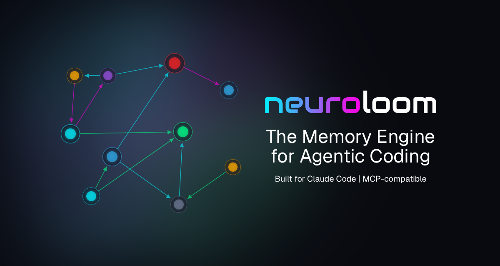

<p align="center">
  
</p>

Claude Code starts every session from scratch - context is lost and the CLAUDE.md grows out of date faster than your README.md. This plugin connects Claude to Neuroloom — the memory engine for agentic coding. Every tool use is captured, relationships between decisions are tracked, and each new session starts with the full graph of your past work.

Using Cursor, Codex or any other coding agent? See the [MCP Integration guide](https://neuroloom.dev/docs/mcp-integration) for the `.mcp.json` setup path.

---

## Prerequisites

- **Claude Code**
- **`python3`** >= 3.11

---

## Installation

### Install from Claude Code Marketplace (recommended)

1. Add the Endless Galaxy Studios marketplace:
   ```bash
   /plugin marketplace add endless-galaxy-studios/claude-plugins
   ```

2. Install Neuroloom:
   ```bash
   /plugin install neuroloom@endless-galaxy-studios
   ```

3. Configure your API key:
   ```bash
   /plugin
   Navigate to Installed --> neuroloom Plugin --> Configure options
   ```
   
4. Restart Claude Code, then verify:
   ```bash
   /neuroloom:status
   ```

#### To upgrade:

```bash
/plugin marketplace update endless-galaxy-studios
```

### Install via pip

1. Install the MCP server:
   ```bash
   pip install neuroloom-mcp
   ```
   
2. Install the plugin:
   ```bash
   neuroloom-mcp install-plugin
   ```

3. Restart Claude Code.

4. Set your API key with `/plugins configure neuroloom` in Claude Code.

#### To upgrade:

To update the MCP server:
   ```bash
   pip install --upgrade neuroloom-mcp
   ```

To update the plugin:
   ```bash
neuroloom-mcp install-plugin --force
   ```

---

## Post-Installation

1. Add `.neuroloom.db*` to your project's `.gitignore` — the file holds your project's API key and session state, and lives in your project root no matter what installation method you use. Write it with the trailing `*`: SQLite also creates `.neuroloom.db-wal` and `.neuroloom.db-shm` next to the database, and a bare `.neuroloom.db` entry does not cover them. Outside CI mode, SessionStart adds the `.neuroloom.db*` line for you if it is missing; in [CI mode](#ci-mode) it never edits `.gitignore`.

2. Initialize workspace memory:
   ```bash
   /neuroloom:init
   ```
   This crawls your codebase in four phases: maps the directory structure, asks a question about priorities, stores 20–40 structured seed memories across your modules, and seeds the code graph with file-level symbols. After init, `memory_search` is useful from the first query.

## What the plugin does

- **Context injection** — before Claude reads a file, Neuroloom injects relevant memories (prior decisions, known gotchas, related patterns) directly into the conversation. Before Glob/Grep searches, it nudges Claude toward relevant memories it might want to query.
- **Observation capture** — every tool use is captured and sent to Neuroloom in the background. When the session ends, Neuroloom extracts structured memories and discovers relationships between them.
- **Code graph sync** — when you edit TypeScript or Python files, the plugin parses the file's structure (functions, classes, imports) via tree-sitter and syncs it to Neuroloom (support for other languages coming soon).
- **MCP tools** — Claude can query Neuroloom directly via `memory_search`, `memory_explore`, `memory_store`, `memory_by_file`, and others.

### Zero-touch bootstrap

`neuroloom-codeweaver` — the code graph sync package — is installed automatically on first SessionStart. No manual install step is needed after a marketplace install.

On the first session after installing the plugin, SessionStart creates a `.venv` in `${CLAUDE_PLUGIN_DATA}` (the persistent per-plugin data directory; in a development clone with no `CLAUDE_PLUGIN_DATA`, inside the plugin directory) and installs `neuroloom-codeweaver` into it in a background thread. If venv creation fails (for example, on macOS where the system Python has `ensurepip` stripped), it falls back to a `--user` install. A `--user` install lands in `~/.local/lib/...` on POSIX or `%APPDATA%\Python\` on Windows — visible to any code running under that interpreter, not isolated to the plugin venv.

If both paths fail, a banner appears in the Claude Code transcript explaining how to install manually:

```
python3 -m pip install neuroloom-codeweaver
```

**Offline or air-gapped environments:** Set `NEUROLOOM_CODEWEAVER_OFFLINE` to any non-empty value to skip the install attempts (the venv, `pip install` and the `--user` fallback). The banner will not fire. This does not turn off the update check: when `neuroloom-codeweaver` is already importable, SessionStart can still ask PyPI for the latest version and run `pip install --upgrade` if a newer one exists, so on a machine with no route to PyPI the check fails quietly and changes nothing.

In [CI mode](#ci-mode) you do not need this variable: CI mode skips the codeweaver install and the upgrade check outright, and never touches PyPI or `pip`.

```bash
export NEUROLOOM_CODEWEAVER_OFFLINE=1
```

### How It Works

All hooks are Python modules in `pyhooks/`, launched via `run_hook.py`. When a `.venv` exists in `${CLAUDE_PLUGIN_DATA}` (or, as the development fallback, inside the plugin directory), hooks run inside it; when it does not, the system Python that invoked the launcher is used as a fallback so all non-codeweaver hooks still run. (CI mode never looks for a venv; see [CI mode](#ci-mode).) State is stored in a single SQLite database (`.neuroloom.db`) using WAL mode for concurrent access.

**Where the database lives.** In every mode, every hook takes its state from one project root: `CLAUDE_PROJECT_DIR` when Claude Code sets it (it stays on the directory the session started in, even after the agent runs `cd`), otherwise the hook process's own working directory. The API key, the session row, the cache keys and the debounce state are all read from and written to `<project root>/.neuroloom.db`. A `cd` into a subdirectory no longer makes hooks look for a second database there.

**SessionStart** — opens a Neuroloom session, replays any buffered observations from the previous session, injects the memory-first rule into `CLAUDE.md` if absent, and prints the tool catalog so Claude knows what's available.

**PreToolUse (context injection)** — fires before `Read`, `Glob`, and `Grep`. Two modes:
- **Inject** (on `Read`) — queries Neuroloom's context endpoint with the file path and injects relevant memories (as `hookSpecificOutput.additionalContext`) before Claude sees the file.
- **Nudge** (on `Glob`/`Grep`) — extracts a meaningful query from the search pattern and injects a compact reminder to check Neuroloom for related context.

Includes a circuit breaker (30s cooldown on API failures), response caching (1hr TTL), and a per-session token budget (~30K chars) to avoid flooding the context window.

**PostToolUse (capture)** — fires after every tool use. Reads the tool event from stdin, applies guard checks (no API key, no session, MCP self-calls, rate throttle), and ships the observation to Neuroloom in a background thread. If the API is unreachable, the payload is buffered in the SQLite `event_buffer` table for replay on the next session start. Exits in under 100ms.

**PostToolUse (code graph sync)** — fires on `Write` and `Edit`. Parses code files to extract functions, classes, and imports via tree-sitter, then syncs the structure to Neuroloom.

### Session Tracing

All hook decisions are recorded in the `traces` table of the SQLite database for post-hoc debugging. Traces capture what each hook decided and why, so you can replay the decision log instead of guessing.

### Code Graph Sync

When you edit TypeScript or Python files, the plugin automatically parses each file's structure — functions, classes, and imports — and syncs it to Neuroloom in the background via the `neuroloom-codeweaver` package. No manual install or calls needed — see [Zero-touch bootstrap](#zero-touch-bootstrap) above. The package is also checked for updates at each session start and upgraded in the background when a newer version is available on PyPI.

## CI mode

CI mode is for **headless** runs: Claude Code started by a script (for example `claude -p` in a GitHub Actions job) with nobody at the keyboard. In that setting the normal hooks are the wrong behaviour. They edit tracked files (`.gitignore`, `CLAUDE.md`, `.mcp.json`), install packages from PyPI, start background threads that can outlive the hook, and upload everything the agent does. CI mode turns all of that off and keeps one thing: it injects memories before the agent reads a file.

The CI-mode contract, in one place:

- The base plugin's hooks send nothing but the `POST /api/v1/context` lookup. The SDLC plugin adds two read-only GETs. MCP tools and skills are not governed by this mode.
- Observations are recorded to the local database only. They are never uploaded.
- No hook edits a tracked file, runs `git`, runs `pip` or `venv`, or starts a thread or subprocess. Each hook process ends when its `main()` returns.
- The project key is not read from any environment variable. A factory step seeds it into `.neuroloom.db` first (see [Seeding the project key](#seeding-the-project-key)). The *factory* is the CI workflow that runs the agent, owned by z-sdlc.

### Quick path

The whole job, in the order it must run. `$ROOT` is one directory: the seed, the agent's start directory and the cleanup all use it.

```bash
ROOT="$GITHUB_WORKSPACE"                                  # 1. locate the project root
rm -rf -- "${ROOT:?}"/.neuroloom.db*                      # 2. delete leftovers from an earlier job
printf %s "$REPO_NEUROLOOM_KEY" \
  | python3 "$NEUROLOOM_CLAUDE_PLUGIN_ROOT/scripts/seed_project_key.py" \
      --project-root "$ROOT"                              # 3. seed (the key is in this step's env: only)
cd "$ROOT" && NEUROLOOM_MODE=ci CLAUDE_PROJECT_DIR="$ROOT" \
  claude -p "$PROMPT" --output-format stream-json --verbose > out.jsonl   # 4. run the agent
grep -F '[Neuroloom CI mode] Ready.' out.jsonl            # 5. fail the job if the ready line is absent
rm -rf -- "${ROOT:?}"/.neuroloom.db*                      # 6. clean up, in an always() step
```

`NEUROLOOM_CLAUDE_PLUGIN_ROOT` is the installed plugin's directory (for example, read it from `claude plugin list --json`). Keep that directory outside the checkout.

### Turning it on: `NEUROLOOM_MODE`

`NEUROLOOM_MODE` is the only switch. Neither `CI` nor `GITHUB_ACTIONS` is consulted. The value is trimmed of whitespace and lower-cased, then read like this:

| `NEUROLOOM_MODE` | Mode |
|---|---|
| unset, empty, or only whitespace | normal |
| `ci` (any case, surrounding whitespace ignored) | CI |
| any other non-empty value (`prod`, `cii`, `off`, `0`, `false`, ...) | **CI**, with a warning on stderr |

The last row is deliberate. The parser **fails closed**: when it cannot tell what you meant, it picks the safe mode. A typo such as `cii` must not leave a CI job running the normal hooks, which write into the checkout and upload tool output. The cost is that `off`, `0` and `false` do not turn CI mode off; they turn it on. **To turn CI mode off, unset the variable.**

Four places read the variable with the same rule: `pyhooks/config.py` (every `load()`), this plugin's `run_hook.py`, the SDLC plugin's `run_hook.py`, and the SDLC plugin's `sdlc_pyhooks`. The launchers decide before `pyhooks` can be imported, so each carries a small copy of the parser.

For an unrecognised value, the base `session_start` writes one line to stderr and carries on in CI mode:

```
[Neuroloom] NEUROLOOM_MODE "off" is not recognised; running in CI mode. Set NEUROLOOM_MODE=ci, or unset it for normal mode.
```

The value is echoed only when, after trimming, it is 1 to 16 characters from `A-Z`, `a-z`, `0-9`, `_` and `-`. Anything else prints `<redacted, N chars>` in its place, so a secret pasted into the wrong variable never reaches a log:

```
[Neuroloom] NEUROLOOM_MODE <redacted, 40 chars> is not recognised; running in CI mode. Set NEUROLOOM_MODE=ci, or unset it for normal mode.
```

### Environment

| Variable | Required | What it does |
|---|---|---|
| `NEUROLOOM_MODE` | yes | `ci` turns CI mode on (see above). |
| `NEUROLOOM_CLAUDE_PLUGIN_ROOT` | yes, for the factory and for the SDLC plugin | An **absolute** path to this plugin's root, a directory containing a real `pyhooks/` package. The base hooks do not read it. The SDLC plugin's launcher uses it as the only way to find this plugin in CI mode (it never searches `~/.claude/plugins/cache` or a sibling directory), and the factory uses it to locate `scripts/seed_project_key.py`. |
| `NEUROLOOM_API_BASE` | no | API base URL. Defaults to `https://api.neuroloom.dev`. |

Claude Code can scrub the environment it passes to child processes (`CLAUDE_CODE_SUBPROCESS_ENV_SCRUB=1`). In a manual run on Claude Code 2.1.314 with the scrub on, `NEUROLOOM_MODE`, `NEUROLOOM_CLAUDE_PLUGIN_ROOT`, `NEUROLOOM_API_BASE`, `CLAUDE_PROJECT_DIR` and `HOME` all reached the hook process (checked by presence only; values were not logged).

### Seeding the project key

CI mode adds no environment variable, config file or other place to put a credential. The key lives where it always does, in the `config` table of `<project root>/.neuroloom.db`, and `scripts/seed_project_key.py` writes it there. Run it before the agent step:

```bash
printf %s "$REPO_NEUROLOOM_KEY" \
  | python3 "$NEUROLOOM_CLAUDE_PLUGIN_ROOT/scripts/seed_project_key.py" \
      --project-root "$GITHUB_WORKSPACE"
```

- **The key comes in on stdin only.** There is no key argument, so the key never shows up in `ps` output or shell history. A key given as an argument is refused, and the message does not echo it.
- **`--project-root` is required.** It must be given once, as a non-empty **absolute** path to an existing directory you can write to. There is no default and no environment fallback. Use the same directory the agent step runs in, because that is where the hooks will look.
- **The key** is trimmed of surrounding whitespace, must be printable ASCII with no spaces inside, and may be at most 4096 bytes on stdin. The script reads the stored key back and fails if it does not match.
- **Use one secret per repository**, scoped to that repository's workspace, never a shared org-level key. Hooks send no workspace id; the key alone decides which workspace a call reaches.
- Re-running replaces the stored key. The script prints `seeded project key into <path>` on stdout, makes no network call, and never touches `.gitignore`, `.mcp.json` or `settings.json`.
- Run seed, agent and cleanup as the **same user**. The database and its sidecar files are created with mode `0600`, so a different uid cannot read them. A leftover regular `.neuroloom.db` from an earlier run is reused and narrowed to `0600`.
- Set `HOME`. The script gives `git` only `PATH` (absolute entries only), `HOME` and `LC_ALL=C`; with `HOME` unset, git may fail with exit 128.

**The ignore precondition.** Before it writes anything, the script asks git whether `.neuroloom.db`, `.neuroloom.db-wal`, `.neuroloom.db-shm` and `.neuroloom.db-journal` are ignored. If any is not, it exits 1, writes nothing, and names the paths. There is no flag to skip the check. The repository's own `.gitignore` needs a rule that makes git ignore all four files; `.neuroloom.db*` is the supported form:

```
.neuroloom.db*
```

A bare `.neuroloom.db` is not enough, because the sidecar files do not match it. Only rules that travel with the repository count: a global git ignore file (`core.excludesFile`, `~/.gitignore`, `~/.config/git/ignore`) is not counted, and a `.git/info/exclude` rule counts but is per clone, so put the line in `.gitignore`. A database file that git already tracks counts as not ignored. The check exists because `git add -A` after the agent step would otherwise commit the key.

The check is skipped, with a note on stderr and exit 0, when `git` is not found on an absolute `PATH` entry or when there is no `.git` at or above the project root. Treat either note as a warning in your workflow: the precondition was not verified.

**Exit codes.** Every failure exits 1 with one line on stderr that starts `seed_project_key: ` and names the reason. No message contains the key or an argument value, and none of the failures below prints a traceback. Success exits 0.

| Reason | Message (abridged where it ends in `...`) |
|---|---|
| Wrong arguments: missing, repeated, unknown or positional argument, an abbreviated flag, or a key passed as an argument | `invalid arguments; usage: seed_project_key.py --project-root DIR (the key is read from stdin, never from an argument)` |
| Bad project root | `--project-root is not an existing directory (an absolute path is required)`; `project root is not writable` |
| Bad key on stdin | `stdin is closed; pipe the key on stdin`; `could not read the key from stdin`; `the key on stdin is too long`; `the key on stdin is not valid UTF-8`; `no key on stdin`; `the key on stdin contains whitespace`; `the key on stdin must be printable ASCII characters only` |
| Database not ignored | `git does not ignore <names>; add an entry to the repository's .gitignore that ignores .neuroloom.db* ...` |
| The ignore check could not run | `git could not be run or timed out in the ignore check`; `the git ignore check failed (git exited 128: a broken repository or git configuration, for example HOME unset with a system gitconfig that needs it); refusing to continue`; `the git ignore check failed for a reason other than 'not ignored' (git exited N) ...` |
| A database file is a link or not an ordinary file | `<name> is a symlink; refusing to write through it`; `<name> is not a regular file with a single link; refusing`; `<name> does not have a single link; refusing`; `<name> is not a regular file; refusing`; `<name> changed while it was being prepared`; `<name> was replaced during the write; the key may have been written through it`; `<name> is a symlink or not a single regular file after the write; the key may have been written through it`; and the `could not inspect`, `could not open ... safely`, `could not create ... safely` and `could not restrict ... to mode 0600` variants |
| The write did not stick | `the key could not be stored; read-back did not match` |

The exit-128 case is how git reports a broken repository or configuration. If the checkout is owned by a different user than the one running the seed step, git may refuse it; the script passes `-c safe.directory=<repo>` to every git call, but that has **not been verified** against a repository owned by another uid (the development machine's git, 2.33.0, predates the behaviour). Record your image's git version, and run the seed step as the checkout's owner.

An interpreter older than 3.10 fails at import with a non-zero exit before any of these messages.

### What each hook does in CI mode

| Hook | Event | CI-mode behaviour |
|---|---|---|
| `session_start` | SessionStart | Prints one of the three lines in the table below. With a key, it opens the database, mints a local session id, writes one `sessions` row and one `ci_started` trace row in a single commit, and prints the ready line. With no key it opens nothing and creates no file. It makes **no** network call, starts no thread or subprocess, and skips everything else: `.gitignore`, `CLAUDE.md` and `.mcp.json` edits, the stale-session POST, `/sessions/start`, the event-buffer flush, trace pruning, the codeweaver install and upgrade, the tool catalog and the codeweaver-degraded banner. |
| `capture` | PostToolUse | The usual guards still apply: no key, no session row, a malformed session id, MCP self-calls, and targets outside the project root. If the event passes, it writes one `event_buffer` row **in the hook's own process** and exits. No request, no thread, and no send-rate throttle. Each recorded event also adds one `ci_recorded` row to the `traces` table (a failed insert adds one `buffer_error` row instead). The 10,000-row cap, trimmed to 8,000, still applies. Each row is capped at 64 KB: a longer `content` is cut and ends with a `…[truncated: original N chars]` marker. |
| `preload_context` | PreToolUse | With no key it prints `{}` and returns before opening the database, so a dormant job creates no file. With a key it looks up context as it does outside CI mode, with the same response cache (1 hour), circuit breaker (30 s) and per-session token budget, with two changes: the request waits up to **10 s** instead of 3 s, and the request body carries no session id. |
| `code_graph_sync` | PostToolUse (Write, Edit) | Exits 0 before reading stdin, opening the database or importing codeweaver. |
| `cache_prefetch` | CwdChanged | Exits 0 before reading stdin, opening the database or starting a thread. |

Every hook uses the project root. In a CI job where the agent runs `cd sub` and then reads a file, the lookup goes out under the root's key with the path relative to the root (`sub/file.py`).

### The three lines CI-mode SessionStart prints

`session_start` prints exactly one of these lines on stdout in CI mode. Factories and workflows grep for them, so the wording is a contract: changing a line is a breaking change and is announced in the [changelog](CHANGELOG.md). The bracketed prefix is part of each line.

| State | Line |
|---|---|
| A key was seeded and the database opened | `[Neuroloom CI mode] Ready. Memory lookups are on; observations are not uploaded.` |
| No key (a missing, corrupt or unreadable database counts as no key) | `[Neuroloom CI mode] No project key was seeded, so Neuroloom is off for this job.` |
| A key is present but the database could not be opened (read-only project directory, full disk, or a locked or corrupt schema) | `[Neuroloom CI mode] The project state could not be opened, so observations are not recorded.` |

None of them names a path, a slash command or the key. Use the first line as proof that a job really entered CI mode: fail the job if it is absent.

In a manual run of `claude -p --output-format stream-json --verbose` on Claude Code 2.1.314, the line appeared in the `stdout` field of the `SessionStart` `hook_response` event, with and without `--include-hook-events`. That run was on a laptop, not in GitHub Actions, and a different Claude Code version may report it differently.

### Python version and `python -I`

The hooks need only the standard library. In CI mode they and the seed script need `python3` **3.10 or later** on `PATH`, because the code uses `X | None` in signatures. The 3.10 floor was checked by compiling the plugin on 3.10.7 and running the seed and launcher tests there. (The general prerequisite at the top of this README is separate.) CI mode never creates the venv, so the launcher runs every hook with `sys.executable`, the `python3` that ran `run_hook.py`, and prints no degraded-venv line.

The launcher starts each hook as `python -I -c <bootstrap>` rather than `python -m <module>`. In CI the working directory is the checkout, and the checkout can contain files the agent or a contributor wrote. `python -m` puts the working directory first on the import path, so a planted `pyhooks/`, `json.py` or `runpy.py` there would be imported and run before the real one. `-I` is Python's **isolated mode**: it keeps the working directory, `PYTHON*` variables and the user site directory off the import path. The bootstrap then adds exactly one directory, the plugin root.

### Cleanup is required

`.neuroloom.db` holds the project key and, in CI mode, a record of what the agent did: `capture` stores each tool event's raw input and output in the `event_buffer` table, up to 64 KB per row, capped at 10,000 rows. Nothing uploads or prunes those rows in CI mode. The key stays valid after the job, and anyone who can read the file can read it.

The factory must delete `.neuroloom.db*` (the database and its `-wal`, `-shm` and `-journal` files) in an `always()` step **right after the agent step**, before any commit, artifact upload or cache save. On a runner that keeps its workspace between jobs, a missed cleanup carries the key and the recordings into the next job.

Delete both before and after the agent step, with `rm -rf -- "${GITHUB_WORKSPACE:?}"/.neuroloom.db*`. A leftover database that gets re-seeded keeps its old `event_buffer`, `sessions` and `traces` rows, so the pre-seed delete matters as much as the post-agent one. `always()` does not run when the runner is lost, so set a step timeout and do not rely on it alone. Seed, agent start directory and cleanup path must be the same directory, and the three steps must run as the same user.

Put the key in the seed step's `env:` only, never at job level, so the agent process never inherits it. Keep the plugin root outside the checkout (`NEUROLOOM_CLAUDE_PLUGIN_ROOT`), so the agent cannot edit the hooks it is about to run.

Worst case, the local record is about 640 MB (10,000 rows at 64 KB each).

Do not reuse a CI database in a normal-mode session. CI rows are written with the same row type that a normal session replays and uploads, so a later normal-mode SessionStart on the same file would send them.

### Known limits

- **Injected memories need this release on Claude Code 2.1.314.** `preload_context` now returns its result as `hookSpecificOutput.additionalContext` (with `hookEventName` `PreToolUse`). Earlier plugin versions printed a top-level `additionalContext`, which Claude Code 2.1.314 ignored, so the model never received the injected text, in normal mode too.
- **Developed and checked on macOS with Claude Code 2.1.314.** The z-sdlc smoke job in GitHub Actions has not run yet.
- **`CLAUDE_PROJECT_DIR` unset in CI** makes the root fall back to the hook process's working directory, so an agent `cd` makes the hooks dormant. Set it, or start the agent in the seeded directory.
- **Skills find the project root themselves.** `/neuroloom:status`, `/neuroloom:workspace` and `/neuroloom:init` run `scripts/project_root.py` (with `python3`, standard library only), which tries, in order: the project directory Claude Code substitutes into the skill text as `${CLAUDE_PROJECT_DIR}` (the true project root, unchanged by a `cd`); the `CLAUDE_PROJECT_DIR` environment variable (set for hooks, not for the Bash tool); the nearest parent directory holding a `.neuroloom.db`; the nearest holding `.git`; the current directory. The marker search never selects `$HOME` or `/`, and the command prints nothing and exits 1 if the working directory was deleted (skills then stop). `scripts/seed_code_graph.py` has no substituted value: init passes it `--workspace-root`, and run alone it uses the environment variable and then the walk-up. Each skill command resolves the root once and passes it to Python as `CLAUDE_PROJECT_DIR`, so the config loader and the snippets agree, and prints `neuroloom: project root is <path>` so a wrong pick is visible. The substitution was verified with `claude -p --plugin-dir`; a marketplace install was not tested. **The walk-up fallback is the only path that can disagree with the hooks**, and only when the substituted value is missing: it searches upward from where you are now, so a stray `.neuroloom.db` in a subdirectory below the project root (for example one left by an older version, which the changelog tells you to delete) is found first from inside that subdirectory. Delete such files. A second fallback-only split: a project whose root is `$HOME` itself (a `~/.git`, or a `~/.neuroloom.db`) is not found by the marker search, so from `~/sub` the fallback resolves `~/sub` while the hooks use `~`. **Skills run through `scripts/skill_python.py`.** Every skill `python -c` snippet starts with `CLAUDE_PLUGIN_DATA="${CLAUDE_PLUGIN_DATA}" python3 "${CLAUDE_PLUGIN_ROOT}/scripts/skill_python.py" -c "..."`. The launcher imports `run_hook._resolve_python`, so a skill gets the interpreter hooks get (CI mode: `sys.executable`; else `${CLAUDE_PLUGIN_DATA}/.venv`; else `<plugin>/.venv`; else the system `python3`, with a one-line stderr notice) and `PYTHONPATH` set to the plugin root, which is how `pyhooks` imports in an installed copy (the data-directory venv does not contain it). In CI mode it runs `python -I` with only the plugin root on `sys.path`, like hooks. Claude Code does not export `CLAUDE_PLUGIN_DATA` to the Bash tool, so the skill passes the value Claude Code substitutes into skill text; an empty, relative or still-literal value is ignored, and the launcher then derives `<plugins>/data/<plugin>-<marketplace>` from its own install path (`<plugins>/cache/<marketplace>/<plugin>/<version>`). Only the launcher's import-and-exec step needs to run on Python 3.9; the snippets themselves run under the resolved interpreter. If no venv is found, the system-`python3` fallback needs Python 3.10 or later, because `pyhooks` fails to import on 3.9. Not verified: a live skill run inside a marketplace-installed plugin; the layout is simulated in `tests/test_skill_python.py`.
- **Windows is untested** for the CI launcher and the seed script.
- **A link swapped into the project directory in the instant before SQLite reopens the database** is detected after the write, not prevented. It needs write access to the project directory, which the seed's own user already has.
- **The context lookup waits up to 10 s** per call. If the state database cannot be opened, lookups also run without the circuit breaker or the token budget, so each one can wait the full 10 s during an API outage.
- **No workspace cross-check.** Nothing verifies that the seeded key belongs to the repository's workspace; that is the one-key-per-repository rule above.

---

## Skills Reference

| Command | Description |
|---------|-------------|
| `/neuroloom:init` | Bootstrap workspace memory — crawls the codebase, stores structured seed memories, and seeds the code graph |
| `/neuroloom:status` | Check session health, buffer depth, and connection |

---

## Troubleshooting

**No observations appearing in the Neuroloom dashboard**

Run `/neuroloom:status` to check that your API key is detected. If the config source shows `unknown`, re-run `/plugins configure neuroloom` to set your key, then restart Claude Code.

**Context not injecting at session start**

Run `/neuroloom:status` to check if a session is active. If not, the SessionStart hook may not have fired — try restarting Claude Code.

**MCP connection fails**

Run `/neuroloom:status` to verify your API key is configured. If the config source shows `unknown`, re-run `/plugins configure neuroloom` to set your key.
